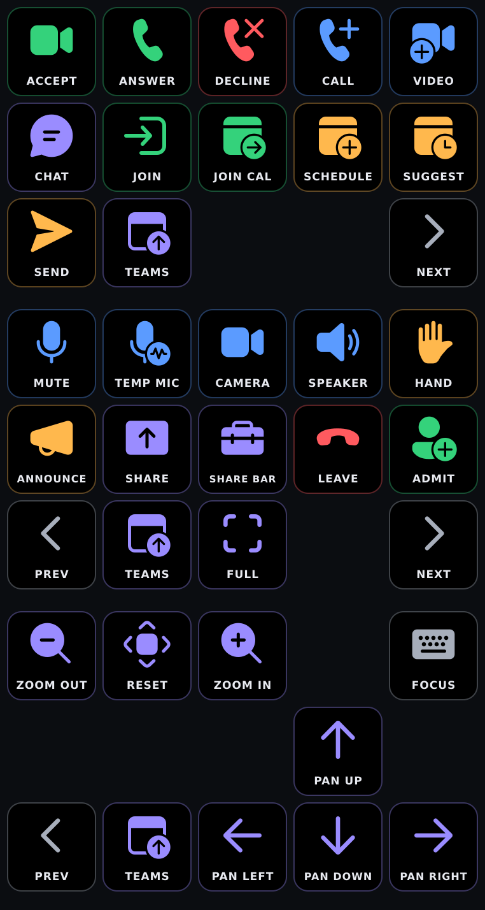
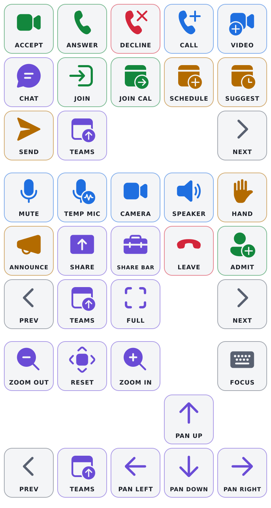

# Microsoft Teams controls for Stream Deck

Stream Deck profiles for Microsoft Teams meeting and call controls on Windows. Uses the built-in Hotkey action to send Teams keyboard shortcuts, so no plugin/API is needed.

Every shortcut in the **Meetings and Calls** section of [Microsoft's Windows desktop shortcut table](https://support.microsoft.com/en-us/accessibility/teams/keyboard-shortcuts-for-microsoft-teams#meetingscallscalendar_newwin32) is included (30 unique shortcuts). Smaller devices spread them over several pages, so nothing is left out and you can rearrange keys to suit.

Most profiles (where space permits) also have a helper key on every page that focuses Teams, so you can press it before pressing another key, as keyboard shortcuts do not work when Teams is out of focus. **Ensure you set its number** to Teams' position on your taskbar (see [Helper key](#helper-key)).

 

## Install
1. Download the file for your device from the [latest release](../../releases/latest). Each device has a **dark** set (black keys) and a **light** set (grey keys); the layouts are identical.
2. Double-click it to import into the Stream Deck app (Windows).
3. From the Stream Deck app, click **Install**.

| Profile | Dark icons | Light icons | Layout | Pages | Status |
|---|---|---|---|---|---|
| 15-key | `Teams-15key-dark.streamDeckProfile` | `Teams-15key-light.streamDeckProfile` | 5×3 | 3 | Tested on MK.2 |
| 32-key | `Teams-32key-dark.streamDeckProfile` | `Teams-32key-light.streamDeckProfile` | 8×4 | 1 | Untested |
| 8-key | `Teams-8key-dark.streamDeckProfile` | `Teams-8key-light.streamDeckProfile` | 4×2 | 6 | Untested |
| 6-key | `Teams-6key-dark.streamDeckProfile` | `Teams-6key-light.streamDeckProfile` | 3×2 | 7 | Untested |

### Device compatibility

| Model | Keys | Profile |
|---|---|---|
| Mini | 6 | 6-key |
| Neo | 8 | 8-key |
| + | 8 + 4 dials | 8-key (dials not used) |
| Stream Deck/Stream Deck MK.2 | 15 | 15-key |
| XL | 32 | 32-key |

If your device has fewer keys than the profile you're installing, the app will not error but only the keys that fit will be kept.

Untested profiles are generated the same way as the tested one but as I don't own those devices, I can only test them on my MK.2. Please [open an issue](../../issues) to say whether they imported and worked.

## Profile layout
- Each key's icon has a short label within the icon, with a more detailed description in its (hidden) **Title**.
- Related keys sit together. The pan keys form an arrow cluster (up above, left/down/right below) on the 32-key, 15-key and 6-key, and a single row (left, up, down, right) on the 8-key profile. Zoom keys are in a row: out, reset, in.
- On multi-page profiles, page 1 always holds the out-of-meeting controls (answering, declining and starting calls). **PREV** and **NEXT** sit in the bottom corners of the 15-key and the top corners of the 8-key and 6-key.
- The **TEAMS** helper key is in the same place on each page of a profile. The 6-key has no room for it without growing from 7 pages to 10 and breaking its arrow cluster, so it's left out; swap it in for a key you don't use if you want it.
- The 32-key fits everything on one page, with one spare key after the TEAMS key.
- All icons are in [`icons/dark`](icons/dark) and [`icons/light`](icons/light) if you want to build your own layout.

## Keys
Shortcuts are for the Teams desktop app on Windows. To build more, press `Ctrl+.` in Teams to show all available keyboard shortcuts.

### Helper key

| Label | Shortcut | What it does | Notes |
|---|---|---|---|
| TEAMS | `Win+Ctrl+1` | Switches to the last active Teams window (usually your meeting). | A Windows taskbar shortcut, not a Teams one. **The `1` assumes Teams is the first app on your taskbar. Change it to Teams' position** (`1`-`9`; `0` is the 10th). Untested; see Limitations. |

**Setting the number:** in Stream Deck, click the TEAMS key, then click the Hotkey field and press `Win+Ctrl` plus the right number. Do this on every page that has a TEAMS key. Teams must be pinned to the taskbar (or running) for the number to count. If you'd rather it open the main window instead of the last active one, use `Win+<number>`.

### Meeting controls

| Label | Shortcut | What it does | Notes |
|---|---|---|---|
| MUTE | `Ctrl+Shift+M` | Mute or unmute your microphone. | Alternatively, 'Win+Alt+K' works without Teams focused but this is known to break with updates. |
| TEMP MIC | `Ctrl+Space` | Temporarily unmute while muted (push-to-talk). | Needs *Keyboard shortcut to unmute* turned on in Teams under Settings > Privacy. |
| CAMERA | `Ctrl+Shift+O` | Turn your camera on or off. |  |
| SPEAKER | `Ctrl+Shift+U` | Turn the speaker on or off. |  |
| HAND | `Ctrl+Shift+K` | Raise or lower your hand in a meeting. |  |
| ANNOUNCE | `Ctrl+Shift+L` | Have raised hands announced by a screen reader. | Intended for screen-reader users. |
| SHARE | `Ctrl+Shift+E` | Open or close the share content tray. |  |
| SHARE BAR | `Ctrl+Shift+Space` | Move keyboard focus to the sharing toolbar. |  |
| LEAVE | `Ctrl+Shift+H` | End the current audio or video call. |  |
| ADMIT | `Ctrl+Shift+Y` | Admit people waiting in the lobby, from the lobby notification. |  |
| FULL | `F11` | Switch full screen on or off. |  |

### Calls and joining

| Label | Shortcut | What it does | Notes |
|---|---|---|---|
| ACCEPT | `Ctrl+Shift+A` | Answer an incoming call with video. | Microsoft's table also lists these keys for Accept screen share. |
| ANSWER | `Ctrl+Shift+S` | Answer an incoming call with audio only. |  |
| DECLINE | `Ctrl+Shift+D` | Decline an incoming call. | Microsoft's table also lists these keys for Decline screen share. |
| CALL | `Alt+Shift+A` | Start an audio call. |  |
| VIDEO | `Alt+Shift+V` | Start a video call. |  |
| CHAT | `Ctrl+Shift+R` | Open the meeting chat from a meeting notification. |  |
| JOIN | `Ctrl+Shift+J` | Join a meeting from its "meeting started" notification. |  |
| JOIN CAL | `Alt+Shift+J` | Join a meeting from its meeting details. |  |

### Scheduling

| Label | Shortcut | What it does | Notes |
|---|---|---|---|
| SCHEDULE | `Alt+N` | Start scheduling a meeting. |  |
| SUGGEST | `Alt+Shift+S` | Go to the suggested time. |  |
| SEND | `Ctrl+S` | Save or send the meeting request. |  |

### Shared content

| Label | Shortcut | What it does | Notes |
|---|---|---|---|
| ZOOM IN | `Alt+Shift+Plus (+)` | Zoom in on shared content. |  |
| ZOOM OUT | `Alt+Shift+Minus (-)` | Zoom out of shared content. |  |
| RESET | `Alt+Shift+0` | Reset the zoom on shared content. |  |
| PAN UP | `Alt+Shift+Up` | Pan shared content up. |  |
| PAN DOWN | `Alt+Shift+Down` | Pan shared content down. |  |
| PAN LEFT | `Alt+Shift+Left` | Pan shared content left. |  |
| PAN RIGHT | `Alt+Shift+Right` | Pan shared content right. |  |

### Other

| Label | Shortcut | What it does | Notes |
|---|---|---|---|
| FOCUS | `Alt+F10` | Move keyboard focus to the toolbar while editing text. |  |

## Limitations
- Teams needs to be the active window for its shortcuts to work.
- Keys send a shortcut so they can't dynamiccaly update, e.g. showing your mute or camera state. If you're looking for dynamic icons, I'd recommend MuteDeck (paid license).
- `profiles-unzipped/` contains the dark release files unzipped, for inspection only (the light files differ only in their icons). Install from the release.

## Building a profile from source

1. Copy a folder from `profiles-unzipped/` (e.g. `Teams-15key-dark`) and edit the files inside. Key settings are in `Profiles/<ID>.sdProfile/Profiles/<PAGE-ID>/manifest.json`, and icons are in each page's `Images/` folder.
2. Zip the **contents** of the folder, so `package.json` and `Profiles/` sit at the top level of the archive, not inside a parent folder.
3. Rename `MyProfile.zip` to `MyProfile.streamDeckProfile` and double-click it to import.

If you add or remove a page, update the page list in the root `manifest.json` too. If nothing happens on import, check the Stream Deck log for errors. Editing a key in the Stream Deck app and exporting the profile is usually easier for small changes.

## Licence
The project's own files are under the MIT Licence ([LICENSE](LICENSE)). The icons are derived from [Microsoft's Fluent UI System Icons](https://github.com/microsoft/fluentui-system-icons), also MIT-licensed; see [THIRD_PARTY_NOTICES.md](THIRD_PARTY_NOTICES.md).

## Disclaimer
Unofficial and not affiliated with Microsoft or Elgato.
